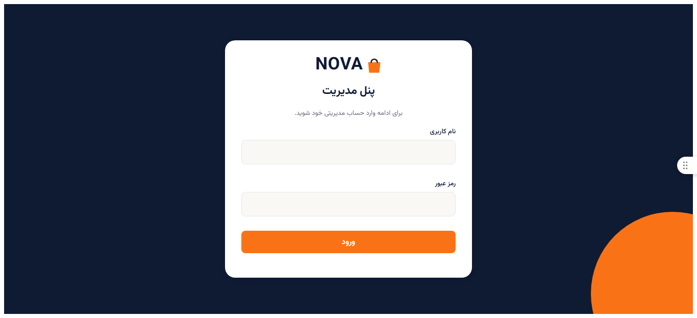
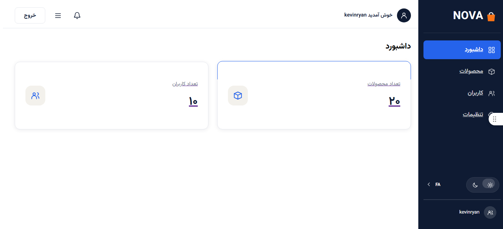

# NOVA Admin

پنل مدیریت فروشگاه اینترنتی NOVA

این پروژه یک پنل مدیریت فروشگاه اینترنتی است که با **React، TypeScript و Vite** توسعه داده شده و برای دریافت و ارسال اطلاعات از FakeStoreAPI استفاده می‌کند.

هدف اصلی پروژه، پیاده‌سازی یک پنل مدیریتی با ساختار منظم، کدهای قابل نگهداری، مدیریت صحیح اطلاعات، ارتباط با API و رابط کاربری ساده و کاربردی بوده است.

در توسعه این پروژه تلاش کردم علاوه بر ظاهر صفحات، روی معماری کامپوننت‌ها، Type Safety، مدیریت State، اعتبارسنجی فرم‌ها و مدیریت خطاها تمرکز کنم.

## ۱. تکنولوژی‌های استفاده‌شده

| تکنولوژی          | کاربرد                                               |
| ----------------- | ---------------------------------------------------- |
| React             | پیاده‌سازی رابط کاربری و کامپوننت‌ها                 |
| TypeScript        | تعریف نوع داده‌ها و کاهش خطاهای کدنویسی              |
| Vite              | راه‌اندازی و Build پروژه                             |
| Redux Toolkit     | مدیریت State مشترک                                   |
| React Router      | مدیریت مسیرها و صفحات                                |
| Axios             | ارتباط با API                                        |
| Formik            | مدیریت فرم‌ها                                        |
| Yup               | اعتبارسنجی اطلاعات فرم                               |
| Styled Components | طراحی کامپوننت‌ها و مدیریت Theme                     |
| Lucide React      | آیکن‌های رابط کاربری                                 |
| FakeStoreAPI      | دریافت اطلاعات آزمایشی محصولات، کاربران و احراز هویت |

## ۲. امکانات پروژه

### احراز هویت

- ورود مدیر با نام کاربری و رمز عبور
- دریافت Token از API
- نگهداری وضعیت ورود در Redux
- محافظت از مسیرهای مدیریتی با Protected Route
- هدایت کاربران واردنشده به صفحه Login
- امکان خروج از حساب کاربری

### داشبورد

- نمایش اطلاعات خلاصه مدیریتی
- استفاده از کارت‌های مشترک برای نمایش اطلاعات
- نمایش اطلاعات محصولات و کاربران
- طراحی هماهنگ با سایر صفحات پنل

### مدیریت محصولات

- دریافت فهرست محصولات از API
- نمایش محصولات در جدول
- جست‌وجوی محصولات
- صفحه‌بندی با نمایش ۷ محصول در هر صفحه
- افزودن محصول جدید
- اعتبارسنجی اطلاعات فرم
- نمایش وضعیت بارگذاری، خطا و حالت خالی
- نمایش پیام موفقیت پس از ثبت محصول

### مدیریت کاربران

- دریافت فهرست کاربران
- نمایش نام کامل، نام کاربری، ایمیل و شماره تماس
- جست‌وجوی کاربران
- صفحه‌بندی
- افزودن کاربر جدید
- اعتبارسنجی اطلاعات کاربر
- نمایش پیام موفقیت یا خطا

### تنظیمات ظاهری

- پشتیبانی از زبان فارسی و انگلیسی
- تغییر جهت صفحات بر اساس زبان RTL و LTR
- پشتیبانی از Light Mode و Dark Mode
- استفاده از رنگ‌ها و استایل‌های مشترک
- امکان تغییر زبان و Theme از طریق Sidebar

## ۳. معماری پروژه

در این پروژه از معماری **Component-Based و ساختار لایه‌ای** استفاده شده است.

هدف این بوده که منطق برنامه، ارتباط با API، مدیریت اطلاعات و طراحی رابط کاربری از یکدیگر جدا باشند.

ساختار اصلی پوشه‌ها:

```text
src/
├── Components/
│   ├── Auth/
│   ├── Dashboard/
│   ├── Layout/
│   ├── Products/
│   └── Users/
│
├── Dictionary/
├── Modals/
├── Pages/
├── Redux/
│   └── slices/
├── Routes/
├── Shared/
│   └── Styles/
├── Storage/
├── types/
│   └── Enums/
├── Utils/
│   ├── api/
│   └── services/
├── Validations/
└── assets/
```

**Components:** کامپوننت‌های مربوط به بخش‌های مختلف مانند محصولات، کاربران، داشبورد و Layout.

**Pages:** صفحات اصلی برنامه که کامپوننت‌ها را کنار هم قرار می‌دهند.

**Shared:** کامپوننت‌های قابل استفاده مجدد مانند Button، Pagination، SearchInput و تنظیمات Theme.

**Redux:** مدیریت اطلاعات مشترک برنامه با استفاده از Sliceها و Async Thunkها.

**Utils/api:** تنظیمات AxiosInstance و مدیریت خطاهای API.

**Utils/services:** توابع دریافت و ارسال اطلاعات محصولات، کاربران و احراز هویت.

**Validations:** اعتبارسنجی فرم‌ها با Yup.

**Dictionary:** متن‌های فارسی و انگلیسی برنامه.

**types:** تعریف Interfaceها، Typeها و Enumها برای Type Safety.

**Modals:** پنجره‌های افزودن محصول و کاربر.

### دلیل انتخاب این معماری

با این ساختار، هر بخش مسئولیت مشخصی دارد و تغییر یک قسمت تا حد امکان روی سایر قسمت‌ها تأثیر نمی‌گذارد.

برای مثال، اگر آدرس API یا نحوه دریافت اطلاعات تغییر کند، معمولاً نیازی به تغییر مستقیم کامپوننت‌های جدول یا فرم نیست و می‌توان تغییرات را در Serviceها مدیریت کرد.

همچنین کامپوننت‌های مشترک باعث کاهش کدهای تکراری و هماهنگی بیشتر طراحی صفحات می‌شوند.

## ۴. مدیریت State با Redux Toolkit

برای مدیریت State مشترک از Redux Toolkit استفاده شده است.

State برنامه به چند بخش تقسیم شده است:

- **authSlice:** وضعیت ورود، Token و اطلاعات موردنیاز احراز هویت
- **productsSlice:** فهرست محصولات و وضعیت دریافت و افزودن محصول
- **usersSlice:** فهرست کاربران و وضعیت دریافت و افزودن کاربر
- **uiSlice:** زبان برنامه، Theme و وضعیت Sidebar

برای درخواست‌های غیرهم‌زمان از `createAsyncThunk` استفاده شده است.

به این ترتیب، وضعیت درخواست‌ها مانند Loading، Success و Failed قابل مدیریت است.

### روند دریافت اطلاعات

```text
Page
  ↓
Redux Async Thunk
  ↓
Service
  ↓
AxiosInstance
  ↓
FakeStoreAPI
  ↓
Redux Store
  ↓
UI
```

اطلاعات دریافتی در Redux نگهداری می‌شوند و کامپوننت‌ها با استفاده از Selectorها به آن‌ها دسترسی دارند.

## ۵. ارتباط با API

برای ارتباط با FakeStoreAPI از یک AxiosInstance مشترک استفاده شده است.

این روش باعث می‌شود تنظیمات درخواست‌ها در یک محل مدیریت شوند.

امکانات AxiosInstance:

- دریافت Base URL از فایل `.env`
- تنظیم Timeout برابر با ۱۰ ثانیه
- افزودن Token به درخواست‌ها در صورت احراز هویت
- مدیریت متمرکز خطاهای ارتباطی
- تبدیل خطاهای API به کدهای قابل استفاده در برنامه

### Endpointهای اصلی

| متد  | آدرس          | کاربرد         |
| ---- | ------------- | -------------- |
| GET  | `/products`   | دریافت محصولات |
| POST | `/products`   | افزودن محصول   |
| GET  | `/users`      | دریافت کاربران |
| POST | `/users`      | افزودن کاربر   |
| POST | `/auth/login` | ورود مدیر      |

توابع دریافت جزئیات محصول و کاربر نیز در Serviceها تعریف شده‌اند.

## ۶. فرم‌ها و اعتبارسنجی

برای مدیریت فرم‌ها از Formik و برای اعتبارسنجی از Yup استفاده شده است.

در فرم افزودن محصول، اطلاعات زیر دریافت می‌شوند:

- عنوان محصول
- توضیحات
- قیمت
- دسته‌بندی
- آدرس تصویر

در فرم افزودن کاربر نیز نام، نام خانوادگی، نام کاربری، ایمیل، رمز عبور و شماره تماس دریافت می‌شوند.

قبل از ارسال اطلاعات، فیلدهای ضروری و فرمت داده‌ها بررسی می‌شوند.

پس از تأیید اعتبار فرم، اطلاعات از طریق Redux و Service مربوط به API ارسال می‌شوند.

### چرا برای تصویر محصول از Image URL استفاده شده است؟

در نسخه نهایی فرم افزودن محصول، به‌جای آپلود مستقیم فایل تصویر، از فیلد **Image URL** استفاده شده است.

دلیل این تصمیم، ساختار FakeStoreAPI است.

در مدل محصول این API، تصویر به‌صورت یک آدرس متنی در فیلد `image` ارسال می‌شود. FakeStoreAPI سرویس آپلود فایل یا فضای ذخیره‌سازی تصویر در اختیار پروژه قرار نمی‌دهد.

بنابراین، آپلود مستقیم یک فایل از کامپیوتر کاربر بدون داشتن سرویس ذخیره‌سازی مستقل، راهکار کاملی نبود؛ زیرا فایل باید ابتدا در یک فضای قابل دسترسی ذخیره شود و سپس آدرس آن برای API ارسال شود.

به همین دلیل تصمیم گرفتم از Image URL استفاده کنم تا:

- ساختار فرم با مدل داده API هماهنگ باشد.
- نیازی به پیاده‌سازی سرویس آپلود جداگانه نباشد.
- پیچیدگی غیرضروری به پروژه اضافه نشود.
- امکان اعتبارسنجی آدرس تصویر وجود داشته باشد.
- تصویر واردشده قبل از ثبت در فرم پیش‌نمایش داده شود.

در یک پروژه واقعی، می‌توان برای آپلود تصویر از سرویس ذخیره‌سازی فایل استفاده کرد و سپس آدرس تصویر ذخیره‌شده را به API ارسال کرد.

## ۷. TypeScript و Type Safety

در بخش‌های مختلف پروژه از TypeScript استفاده شده است.

برای داده‌های محصولات، کاربران، احراز هویت، درخواست‌ها و پاسخ‌های API، Type و Interface تعریف شده است.

همچنین وضعیت‌های برنامه مانند RequestStatus و ApiErrorCode با Enum مدیریت می‌شوند.

این کار باعث شده ساختار داده‌ها مشخص‌تر باشد، خطاهای مربوط به نوع داده زودتر شناسایی شوند و نگهداری کد ساده‌تر شود.

برای بررسی TypeScript از دستور زیر استفاده می‌شود:

```bash
npm run typecheck
```

## ۸. دوزبانه بودن و Theme

پروژه از دو زبان فارسی و انگلیسی پشتیبانی می‌کند.

متن‌های رابط کاربری در فایل‌های Dictionary نگهداری می‌شوند و کامپوننت‌ها بر اساس زبان انتخاب‌شده، متن مناسب را نمایش می‌دهند.

با تغییر زبان، جهت نمایش رابط کاربری نیز بین RTL و LTR تغییر می‌کند.

برای مدیریت ظاهر برنامه از Styled Components و Theme استفاده شده است.

رنگ‌ها، فاصله‌ها، اندازه فونت‌ها و سایر مشخصات طراحی تا حد امکان به‌صورت مشترک تعریف شده‌اند.

این ساختار امکان استفاده از Light Mode و Dark Mode را بدون طراحی مجدد هر صفحه فراهم می‌کند.

## ۹. طراحی رابط کاربری و Responsive

طراحی پنل بر اساس یک هویت بصری مشترک انجام شده است.

در طراحی از رنگ سرمه‌ای برای بخش‌های اصلی، آبی برای دکمه‌های عملیاتی و رنگ‌های متناسب با Light/Dark Theme استفاده شده است.

در صفحات از کامپوننت‌های مشترک برای جدول‌ها، فرم‌ها، دکمه‌ها و صفحه‌بندی استفاده شده است.

برای نمایش جدول‌ها در عرض‌های محدود، امکان اسکرول افقی در نظر گرفته شده و برخی فرم‌ها نیز با تغییر عرض صفحه، چیدمان خود را تغییر می‌دهند.

تمرکز اصلی این نسخه بر معماری، عملکرد، کیفیت کد و تجربه استفاده در محیط دسکتاپ بوده است؛ بنابراین بهینه‌سازی کامل همه صفحات برای موبایل جزو اولویت‌های اصلی توسعه نبوده است.

## ۱۰. مدیریت خطا و Clean Code

برای مدیریت خطاهای API از یک ساختار متمرکز استفاده شده است.

خطاهای ارتباطی در AxiosInstance بررسی و به کدهای مشخص تبدیل می‌شوند.

سپس Redux و کامپوننت‌ها بر اساس وضعیت درخواست، پیام مناسب را به کاربر نمایش می‌دهند.

برای خواناتر شدن کدها و کاهش تکرار، تلاش شده است:

- کامپوننت‌ها مسئولیت مشخصی داشته باشند.
- ارتباط مستقیم با API در Serviceها انجام شود.
- منطق State از رابط کاربری جدا باشد.
- فرم‌ها و Schemaهای اعتبارسنجی مستقل باشند.
- کامپوننت‌های مشترک دوباره استفاده شوند.
- متن‌های رابط کاربری از Dictionary دریافت شوند.
- Typeها در فایل‌های مستقل نگهداری شوند.

## ۱۱. محدودیت‌های FakeStoreAPI

از آنجا که پروژه از یک API آزمایشی استفاده می‌کند، برخی قابلیت‌ها محدودیت دارند.

### ذخیره نشدن دائمی اطلاعات

درخواست‌های POST برای افزودن محصول یا کاربر، پاسخ آزمایشی برمی‌گردانند و اطلاعات را به‌صورت دائمی روی سرور ذخیره نمی‌کنند.

برای مدیریت این موضوع، بعد از دریافت پاسخ موفق، اطلاعات جدید به Redux اضافه می‌شوند تا کاربر بتواند نتیجه ثبت را در جدول مشاهده کند.

این اطلاعات موقتی هستند و پس از Refresh صفحه از بین می‌روند.

### صفحه‌بندی و جست‌وجو

به دلیل محدودیت API در صفحه‌بندی موردنیاز پروژه، ابتدا اطلاعات دریافت می‌شوند و سپس جست‌وجو و Pagination در سمت Frontend انجام می‌شوند.

در هر صفحه حداکثر ۷ رکورد نمایش داده می‌شود.

### شناسه رکوردهای جدید

در برخی پاسخ‌های آزمایشی، شناسه رکورد جدید ممکن است با شناسه رکوردهای موجود تکراری باشد.

برای جلوگیری از تداخل در فهرست فعلی، در صورت نیاز یک شناسه محلی یکتا تولید می‌شود.

### محدودیت احراز هویت

FakeStoreAPI یک سیستم احراز هویت واقعی و کامل ارائه نمی‌کند.

Token دریافتی برای مدیریت وضعیت ورود در این پروژه استفاده شده است و نباید آن را معادل امنیت یک سامانه عملیاتی واقعی در نظر گرفت.

همچنین اطلاعات ورود در حافظه Redux نگهداری می‌شوند و پس از Refresh صفحه از بین می‌روند.

## ۱۲. نصب و اجرای پروژه

### پیش‌نیازها

- Node.js نسخه سازگار با پروژه
- npm
- Git
- یک مرورگر جدید مانند Chrome

### دریافت پروژه

```bash
git clone <repository-url>
cd nova-admin
```

### نصب پکیج‌ها

```bash
npm install
```

### تنظیم متغیرهای محیطی

از فایل `.env.example` یک نسخه با نام `.env` بسازید.

محتوای فایل:

```env
VITE_API_BASE_URL=https://fakestoreapi.com
```

این فایل فقط شامل آدرس API آزمایشی است و اطلاعات محرمانه‌ای ندارد.

### اجرای پروژه

```bash
npm run dev
```

### بررسی TypeScript

```bash
npm run typecheck
```

### Build نهایی

```bash
npm run build
```

برای مشاهده نسخه Build شده:

```bash
npm run preview
```

## ۱۳. تصاویر پروژه

تصاویر محیط واقعی پروژه در مسیر زیر قرار می‌گیرند:

```text
public/
└── screenshots/
    ├── login.png
    ├── dashboard.png
    ├── products.png
    ├── create-product.png
    ├── users.png
    ├── create-user.png
    └── dark-mode.png
```

### صفحه ورود



### داشبورد



### مدیریت محصولات


### افزودن محصول


### مدیریت کاربران


### افزودن کاربر


### حالت تاریک


## ۱۴. روند توسعه پروژه

پروژه به‌صورت مرحله‌ای توسعه داده شده است.

در ابتدا ساختار اولیه React، Vite و TypeScript ایجاد شد.

سپس معماری پوشه‌ها، مسیرها، تنظیمات Theme و کامپوننت‌های مشترک پیاده‌سازی شدند.

در مرحله بعد، سیستم احراز هویت و مدیریت State با Redux Toolkit اضافه شد.

پس از آن، داشبورد و بخش مدیریت محصولات توسعه داده شدند.

در ادامه، بخش مدیریت کاربران، فرم‌ها، اعتبارسنجی و ارتباط با API تکمیل شد.

در مراحل پایانی نیز دوزبانه بودن، هماهنگی ظاهری، مدیریت خطاها، بررسی TypeScript و بهبود ساختار کامپوننت‌ها انجام شد.

تغییرات پروژه در Git با Commitهای مرحله‌ای و معنادار ثبت شده‌اند.

## ۱۵. جمع‌بندی

در توسعه NOVA Admin تلاش کردم یک پنل مدیریت با معماری قابل فهم و قابل توسعه ایجاد کنم.

مهم‌ترین بخش‌های این پروژه از نظر فنی، جداسازی مسئولیت کامپوننت‌ها، مدیریت State با Redux Toolkit، ارتباط متمرکز با API، استفاده از TypeScript، اعتبارسنجی فرم‌ها و مدیریت دوزبانه رابط کاربری بوده‌اند.

همچنین محدودیت‌های FakeStoreAPI به‌صورت مشخص در نظر گرفته شده‌اند و برای آن‌ها راهکارهای موقت در سمت Frontend پیاده‌سازی شده است.

این پروژه بخش **Admin** از تمرین فنی NOVA است.

بخش فروشگاه عمومی NOVA Store به‌صورت پروژه‌ای مستقل با Next.js توسعه داده شده و مستندات جداگانه‌ای دارد.
