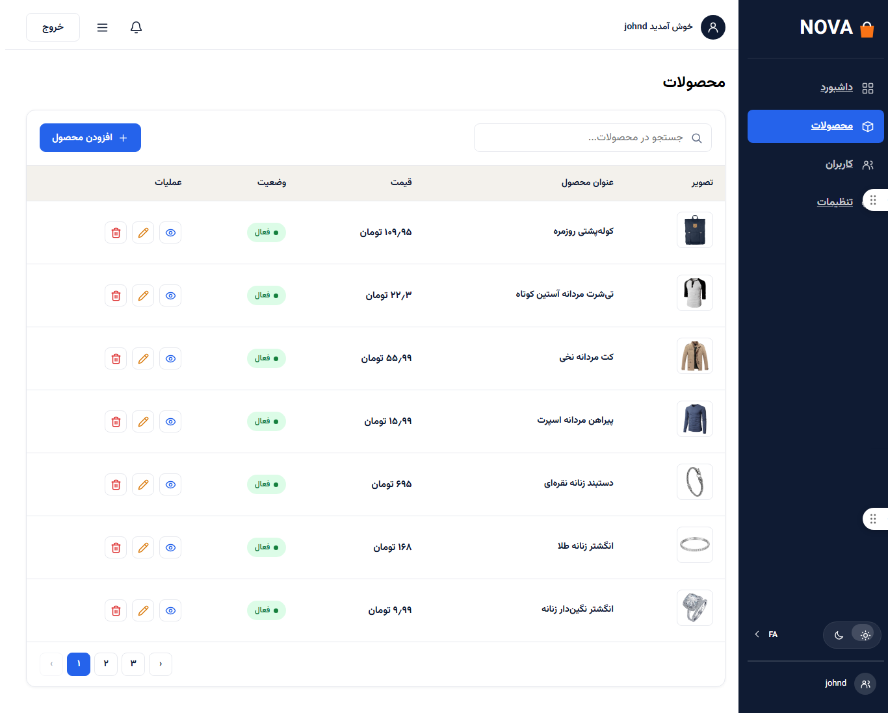
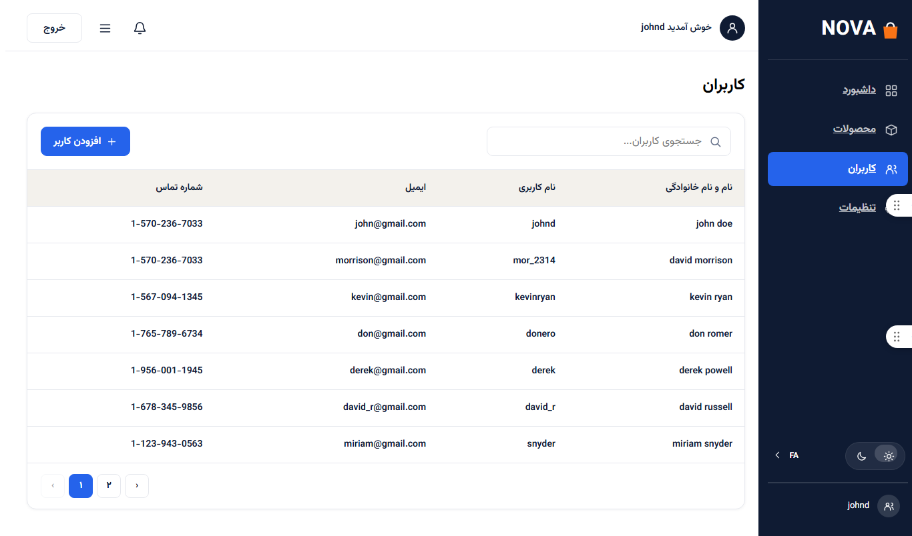
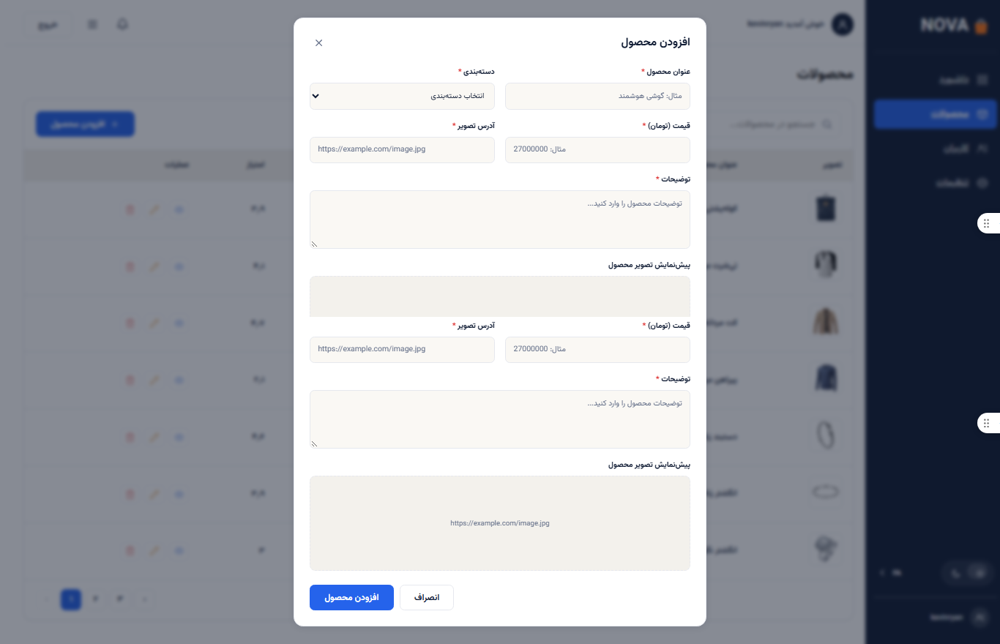
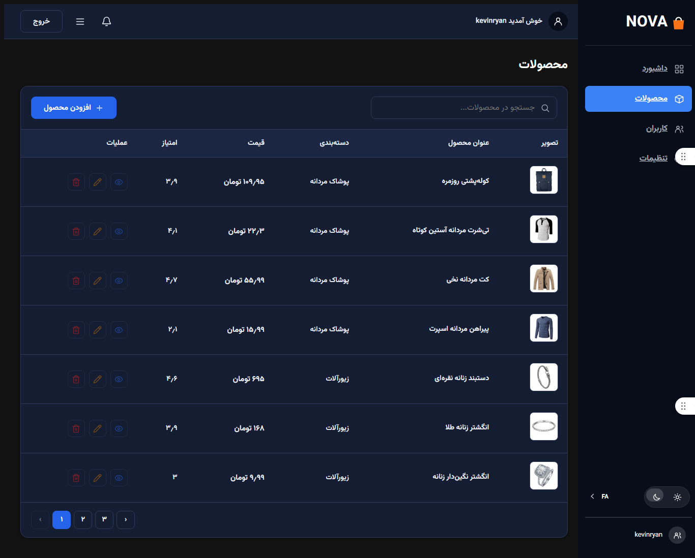
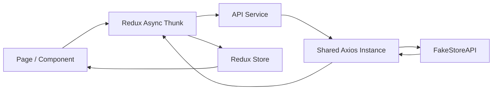
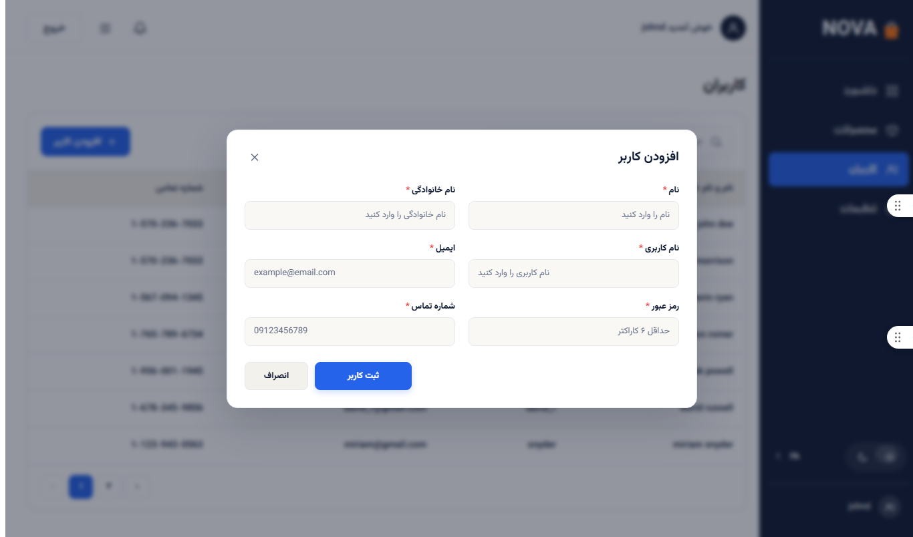

<div align="center" dir="rtl">

# NOVA Admin

**A bilingual e-commerce administration dashboard built with React, TypeScript and Redux Toolkit.**

پنل مدیریت فروشگاه NOVA با پشتیبانی از فارسی و انگلیسی، چیدمان RTL/LTR و تم روشن و تاریک

[](https://react.dev/)
[](https://www.typescriptlang.org/)
[](https://vite.dev/)
[](https://redux-toolkit.js.org/)
[](https://styled-components.com/)

[**Source Code**](https://github.com/fatemeh-abed/nova-admin) · [**Quick Start**](#quick-start) · [**English Summary**](#english-summary)

</div>

<div align="center" dir="rtl">
  
</div>

<table dir="rtl">
  <tr>
    <td width="50%"></td>
    <td width="50%"></td>
  </tr>
  <tr>
    <td align="center"><strong>Products</strong></td>
    <td align="center"><strong>Users</strong></td>
  </tr>
  <tr>
    <td></td>
    <td></td>
  </tr>
  <tr>
    <td align="center"><strong>Create Product</strong></td>
    <td align="center"><strong>Dark Mode</strong></td>
  </tr>
</table>

> **Demo status:** نسخه آنلاین عمومی برای این مخزن در README تأیید نشده است. پروژه را می‌توان با راهنمای زیر به‌صورت محلی اجرا کرد. GIF نمایشی نیز تا زمان تهیه فایل واقعی اضافه نشده است.

<div dir="rtl" align="right">

## معرفی کوتاه

**NOVA Admin** یک پنل مدیریت فروشگاه است که با معماری مبتنی بر کامپوننت و تفکیک لایه‌های UI، مدیریت State و ارتباط با API توسعه داده شده است. پروژه شامل ورود مدیر، داشبورد، مدیریت محصولات و کاربران، فرم‌های اعتبارسنجی‌شده، جست‌وجو، صفحه‌بندی و تنظیمات زبان و ظاهر است.

### فهرست مطالب

- [امکانات اصلی](#امکانات-اصلی)
- [تست سریع پروژه](#quick-start)
- [معماری و جریان داده](#معماری-و-جریان-داده)
- [تصمیم‌های فنی](#تصمیمهای-فنی)
- [مهندسی در دل محدودیت‌ها](#مهندسی-در-دل-محدودیتها)
- [نصب و اجرا](#نصب-و-اجرا)
- [ساختار پروژه](#ساختار-پروژه)
- [تصاویر بیشتر](#تصاویر-بیشتر)
- [نقشه راه](#نقشه-راه)

## امکانات اصلی

| بخش                | قابلیت‌ها                                                                           |
| ------------------ | ----------------------------------------------------------------------------------- |
| **Authentication** | ورود با API، دریافت Token، نگهداری وضعیت ورود در Redux و محافظت از مسیرها           |
| **Dashboard**      | نمایش خلاصه اطلاعات محصولات و کاربران                                               |
| **Products**       | جدول، جست‌وجو، صفحه‌بندی ۷ رکوردی، افزودن محصول و نمایش وضعیت‌های بارگذاری/خطا/خالی |
| **Users**          | جدول کاربران، جست‌وجو، صفحه‌بندی و افزودن کاربر                                     |
| **Forms**          | مدیریت فرم با Formik، اعتبارسنجی Yup و پیام موفقیت یا خطا                           |
| **Localization**   | فارسی و انگلیسی همراه با تغییر جهت RTL/LTR                                          |
| **Theming**        | حالت روشن/تاریک با Styled Components و توکن‌های مشترک                               |

## Quick Start

برای بررسی پروژه در محیط محلی:

```bash
git clone https://github.com/fatemeh-abed/nova-admin.git
cd nova-admin
npm install
```

فایل `.env.example` را با نام `.env` کپی کنید و سپس اجرا کنید:

```bash
npm run dev
```

مقدار موردنیاز در `.env`:

```env
VITE_API_BASE_URL=https://fakestoreapi.com
```

**ورود آزمایشی:** این پروژه از `POST /auth/login` سرویس FakeStoreAPI استفاده می‌کند. برای انتخاب حساب تست معتبر، به [مستندات رسمی FakeStoreAPI](https://fakestoreapi.com/docs) مراجعه کنید. نام کاربری و رمز عبور در کد پروژه Hardcode نشده‌اند و این README نیز اعتبار یک حساب مشخص را بدون تست تأیید نمی‌کند.

**مسیر پیشنهادی تست:** ورود به پنل ← مشاهده محصولات و جست‌وجو ← افزودن محصول با Image URL ← تغییر زبان و تم از Sidebar.

## معماری و جریان داده

**Stack:** React · TypeScript · Vite · Redux Toolkit · React Router · Axios · Formik · Yup · Styled Components · Lucide React

منطق درخواست‌های API در Serviceها، مدیریت State در Redux و نمایش داده در کامپوننت‌ها قرار دارد. برای عملیات غیرهم‌زمان از `createAsyncThunk` و برای خواندن State از Selectorها استفاده می‌شود.



State در Sliceهای مستقل نگهداری می‌شود: `authSlice`، `productsSlice`، `usersSlice` و `uiSlice`. ارتباط با API از طریق AxiosInstance مشترک انجام می‌شود؛ Base URL از محیط خوانده می‌شود، Timeout برابر ۱۰ ثانیه است و خطاهای API به کدهای قابل مدیریت تبدیل می‌شوند.

## تصمیم‌های فنی

| تصمیم                               | گزینه جایگزین                 | دلیل انتخاب در این پروژه                                                                                                   |
| ----------------------------------- | ----------------------------- | -------------------------------------------------------------------------------------------------------------------------- |
| **Image URL** برای تصویر محصول      | آپلود مستقیم فایل             | FakeStoreAPI آدرس تصویر می‌پذیرد اما سرویس ذخیره فایل ارائه نمی‌دهد؛ پیش‌نمایش و اعتبارسنجی URL نیز در فرم امکان‌پذیر است. |
| **جست‌وجو و صفحه‌بندی در Frontend** | Query و Pagination سمت سرور   | داده‌های آزمایشی دریافت و متناسب با نیاز جدول در کلاینت پردازش می‌شوند.                                                    |
| **شناسه محلی یکتا در صورت نیاز**    | اتکا به ID پاسخ POST          | پاسخ‌های آزمایشی ممکن است ID تکراری داشته باشند؛ جلوگیری از تداخل رکوردهای جدول مهم است.                                   |
| **Formik + Yup**                    | مدیریت دستی فرم و اعتبارسنجی  | تفکیک وضعیت فرم از Schema اعتبارسنجی و نمایش خطاهای فیلدها.                                                                |
| **Redux Toolkit + Async Thunk**     | State محلی برای تمام صفحات    | هماهنگ‌سازی وضعیت درخواست‌ها و داده‌های مشترک در چند صفحه.                                                                 |
| **Service Layer + AxiosInstance**   | درخواست مستقیم از کامپوننت‌ها | متمرکزکردن تنظیمات API، مدیریت خطا و کاهش وابستگی UI به سرویس.                                                             |

## مهندسی در دل محدودیت‌ها

**FakeStoreAPI یک Backend عملیاتی نیست.** محدودیت‌ها و راه‌حل‌های نسخه فعلی به‌صورت شفاف مشخص شده‌اند:

| محدودیت                                                       | راه‌حل فعلی / اثر روی کاربر                                                                                  |
| ------------------------------------------------------------- | ------------------------------------------------------------------------------------------------------------ |
| `POST /products` و `POST /users` داده را دائمی ذخیره نمی‌کنند | پس از پاسخ موفق، رکورد به Redux اضافه می‌شود و در جدول دیده می‌شود؛ **با Refresh از بین می‌رود**.            |
| شناسه پاسخ POST ممکن است تکراری باشد                          | در صورت نیاز، شناسه محلی یکتا برای نمایش رکورد ساخته می‌شود.                                                 |
| سرویس آپلود فایل وجود ندارد                                   | فرم محصول `Image URL` دریافت می‌کند؛ برای آپلود واقعی به فضای ذخیره‌سازی و Backend نیاز است.                 |
| احراز هویت API محدود و آزمایشی است                            | Token برای وضعیت ورود استفاده می‌شود؛ **معادل امنیت Production نیست** و وضعیت ورود با Refresh از دست می‌رود. |
| اولویت توسعه با دسکتاپ بوده است                               | اسکرول افقی جدول‌ها و برخی تطبیق‌های عرضی وجود دارد؛ **ریسپانسیو کامل موبایل هنوز انجام نشده است**.          |

## نصب و اجرا

**پیش‌نیاز:** Node.js و npm سازگار با نسخه‌های درج‌شده در `package.json` و Vite نصب‌شده در پروژه. برای انتخاب نسخه دقیق، فیلد `engines` و نسخه Vite در مخزن را بررسی کنید؛ در این README نسخه‌ای که از پیکربندی پروژه تأیید نشده، ادعا نشده است.

```bash
# Install
npm install

# Development
npm run dev

# TypeScript checks
npm run typecheck

# Production build
npm run build

# Preview production build
npm run preview
```

<details dir="rtl">
<summary dir="rtl"><strong>Endpointهای اصلی API</strong></summary>

| Method | Endpoint      | کاربرد               |
| ------ | ------------- | -------------------- |
| `POST` | `/auth/login` | ورود                 |
| `GET`  | `/products`   | فهرست محصولات        |
| `POST` | `/products`   | افزودن آزمایشی محصول |
| `GET`  | `/users`      | فهرست کاربران        |
| `POST` | `/users`      | افزودن آزمایشی کاربر |

</details>

## ساختار پروژه

<details dir="rtl">
<summary dir="rtl"><strong>نمایش پوشه‌ها و مسئولیت هر بخش</strong></summary>

```text
src/
├── Components/       # اجزای اختصاصی Auth، Dashboard، Layout، Products، Users
├── Dictionary/       # متن‌های فارسی و انگلیسی
├── Modals/           # فرم‌ها و پنجره‌های افزودن
├── Pages/            # صفحات سطح Route
├── Redux/            # Store، Sliceها و Async Thunkها
├── Routes/           # مسیرها و کنترل دسترسی به صفحات
├── Shared/           # کامپوننت‌های مشترک و استایل‌ها
├── Storage/          # ابزارهای ذخیره‌سازی سمت کلاینت
├── types/            # Type، Interface و Enum
├── Utils/
│   ├── api/          # AxiosInstance و مدیریت خطا
│   └── services/     # سرویس‌های Auth، Products و Users
├── Validations/      # Schemaهای Yup
└── assets/           # منابع بصری و فایل‌های استاتیک واردشده به برنامه
```

ساختار بالا بر اساس پوشه‌های مستندشده در پروژه است. جزئیات پیاده‌سازی هر بخش در کد همان پوشه قابل بررسی است.

</details>

## تصاویر بیشتر

<table dir="rtl">
<tr>
<td width="50%"></td>
<td width="50%"></td>
</tr>
<tr>
<td align="center">ورود</td>
<td align="center">افزودن کاربر</td>
</tr>
</table>

## نقشه راه

در صورت تبدیل این نمونه به محصول عملیاتی، اولویت‌های توسعه عبارت‌اند از:

1. Backend واقعی و پایگاه داده برای ذخیره دائمی محصولات و کاربران.
2. احراز هویت سمت سرور و مدیریت Session با Cookie امن `HttpOnly` و تنظیمات مناسب CSRF.
3. کش، همگام‌سازی و مدیریت درخواست‌ها با ابزارهایی مانند TanStack Query در صورت نیاز معماری.
4. تست واحد و یکپارچه با Vitest و React Testing Library، به‌همراه تست سناریوهای کلیدی.
5. آپلود واقعی تصویر با اعتبارسنجی نوع/حجم فایل و سرویس ذخیره‌سازی.
6. تکمیل ریسپانسیو موبایل و بررسی دسترس‌پذیری.

</div>

---

<div dir="ltr" align="left">

## English Summary

**NOVA Admin** is a React + TypeScript e-commerce administration dashboard powered by Vite, Redux Toolkit, Axios, Formik, Yup and Styled Components. It includes demo authentication, protected routes, product and user management, validated forms, search and client-side pagination. The interface supports Persian/English, RTL/LTR layouts and light/dark themes. FakeStoreAPI is used as a mock backend; newly created records are not persisted on the server. The project prioritizes maintainable architecture, explicit API boundaries and type safety over production-ready backend functionality.

**Run locally:** `npm install` → configure `.env` from `.env.example` → `npm run dev`.

</div>
